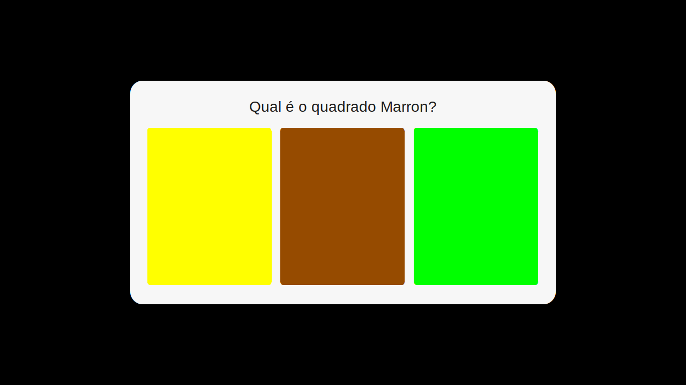
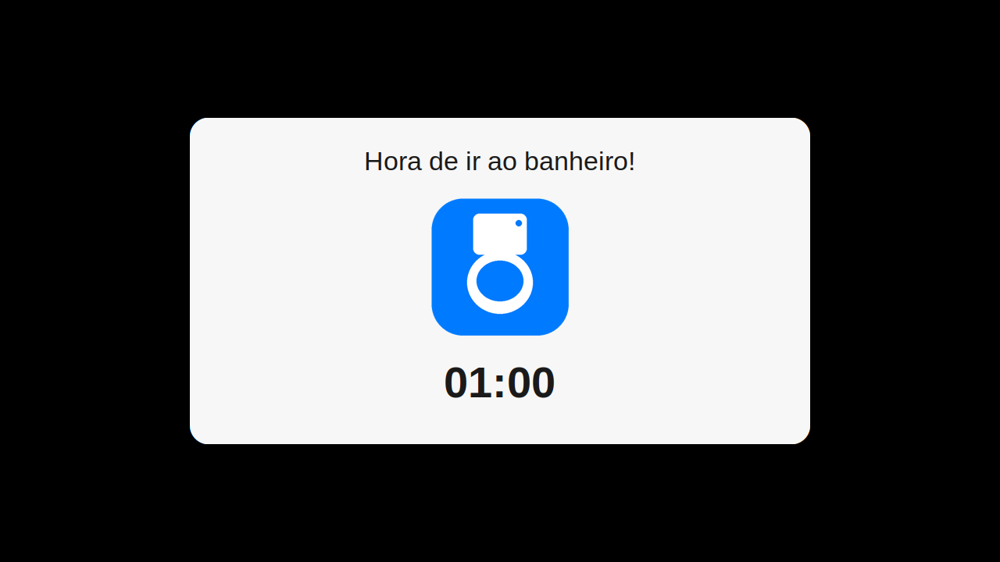
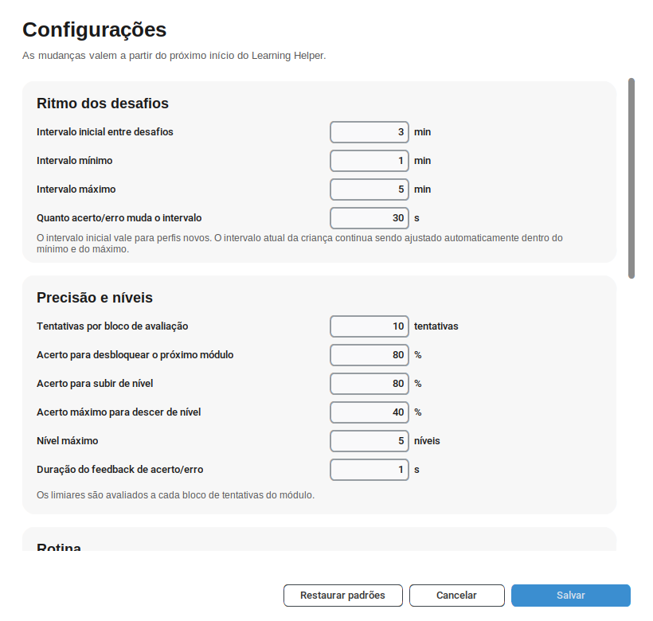
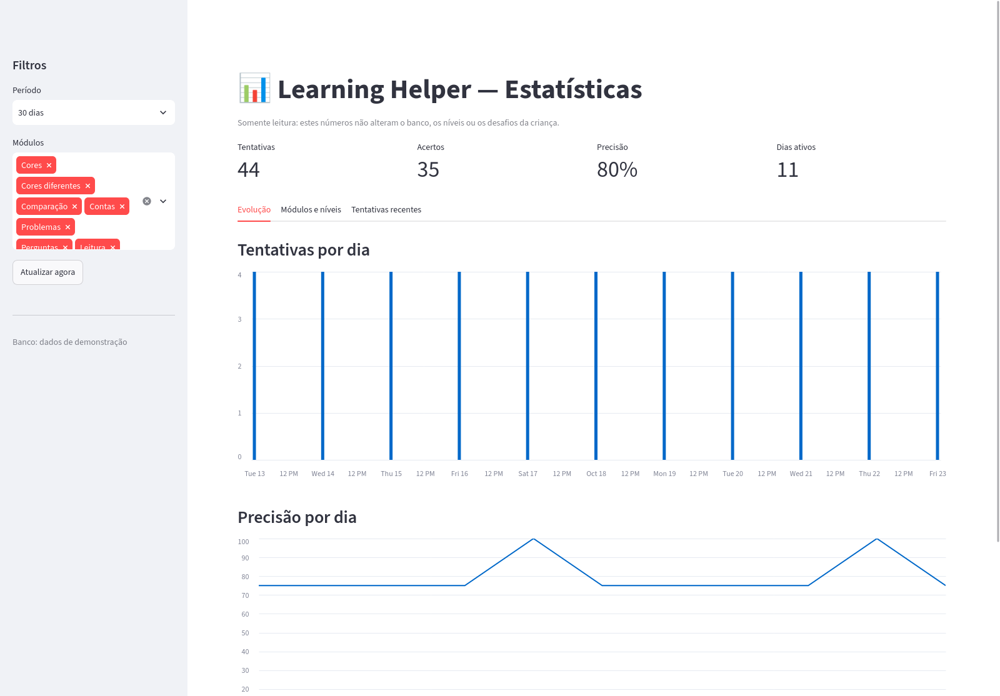

# learning_helper

**Um apoio de aprendizagem e rotina para meu filho autista.**

O learning_helper nasceu de uma necessidade concreta da nossa família: oferecer ao meu filho, de 9 anos, uma forma previsível e acolhedora de exercitar habilidades cognitivas e de raciocínio lógico, ao mesmo tempo em que o apoia na rotina de ir ao banheiro nos momentos certos.

A proposta é diferente de uma plataforma de estudos. Em vez de sessões longas ou telas cheias de estímulos, o app aparece de tempos em tempos com um desafio curto: uma pergunta em português, alternativas claras e um layout que não muda. A dificuldade acompanha o desempenho dele — sobe quando ele acerta e desce quando precisa de mais apoio —, para que o aprendizado continue desafiador sem virar cobrança ou frustração.

São atividades de cores, comparação, contas, problemas, perguntas e leitura. Elas exercitam atenção, linguagem, memória de trabalho e resolução de problemas, sempre em pequenas doses que cabem na rotina.

O lembrete de banheiro segue a mesma lógica de suporte: um aviso visual simples, com contagem regressiva, que ajuda na transição e na autonomia. Ele não é uma punição nem interrompe o aprendizado; faz parte do cuidado com a rotina.

Tudo funciona localmente, os dados ficam na máquina e os intervalos, módulos e limites podem ser ajustados pelos adultos. O objetivo não é substituir acompanhamento pedagógico, fonoaudiológico ou terapêutico, mas criar uma ponte leve entre as necessidades do dia a dia e pequenos momentos de aprendizagem.

- 7 módulos: cores, cores diferentes, comparação, contas, problemas, perguntas e leitura
- Intervalo adaptativo entre 1 e 5 minutos, ajustado pelas respostas
- Resposta errada bloqueia a tela com contagem regressiva (1 minuto por padrão)
- Alternativas liberadas após 5 segundos, com lembrete para ler com atenção
- Tela de configurações na primeira execução e depois pelo atalho/CLI
- Estatísticas no navegador (tentativas, acertos, níveis e evolução)
- Lembrete de banheiro a cada 30 minutos, bloqueando a tela por 1 minuto
- Instalação por usuário, sem root, no Windows e no Linux
- Atualização silenciosa pelo GitHub Releases, com verificação SHA-256
- Dados guardados só na máquina, em SQLite

## Instalação

Os pacotes ficam nas [releases do GitHub](https://github.com/herossa/learning_helper/releases). Todos instalam **apenas para o usuário atual** por padrão, sem pedir senha de administrador, e **preservam o banco de dados ao desinstalar**. Versões instaladas também se atualizam sozinhas: veja [Atualizações](#atualizações).

Cada release publica também um `SHA256SUMS` para conferir a integridade dos arquivos baixados:

```bash
sha256sum -c SHA256SUMS          # Linux, na pasta dos downloads
```

```powershell
Get-FileHash .\LearningHelper* -Algorithm SHA256   # Windows, compare com o SHA256SUMS
```

### Windows 10/11 (x64)

Baixe `LearningHelper-<versão>-Setup.exe` e execute. O instalador não é assinado digitalmente, então o SmartScreen pode avisar: clique em **Mais informações → Executar assim mesmo**.

O instalador:

- instala em `%LOCALAPPDATA%\Programs\LearningHelper` por padrão;
- oferece a opção de instalar para todos os usuários (requer administrador);
- cria atalhos no menu Iniciar para o app, **Configurações** e **Estatísticas**, e, se você quiser, na área de trabalho;
- pode iniciar junto com o Windows, **somente para o usuário atual** (caixa marcada por padrão, pode ser desmarcada);
- ao atualizar, encerra o app, as configurações e o servidor de estatísticas antes de substituir os arquivos.

Para desinstalar, use **Configurações → Aplicativos → Learning Helper** (ou o atalho "Desinstalar" no menu Iniciar). O desinstalador encerra o app, as configurações e o servidor de estatísticas que estiverem abertos. O banco e os logs em `%LOCALAPPDATA%\learning_helper` são mantidos; apague essa pasta manualmente para remover tudo.

Se você escolheu instalar **para todos os usuários** (opção que pede administrador), a atualização automática também funciona, mas o Windows pode pedir elevação (UAC) antes de instalar. A instalação padrão, por usuário, atualiza sem nenhuma janela.

Para habilitar ou desabilitar o autostart depois, pressione `Win+R`, digite `shell:startup` e adicione/remova o atalho "Learning Helper" dessa pasta. As demais opções ficam no atalho **Configurações do Learning Helper**.

### Linux (x86_64)

Há dois formatos: **AppImage** (arquivo único, não instala nada no sistema) e **pacote tar.gz** com instalador por usuário.

#### AppImage

```bash
chmod +x LearningHelper-<versão>-x86_64.AppImage   # o download não mantém a permissão de execução
./LearningHelper-<versão>-x86_64.AppImage
```

O banco e os logs continuam em `~/.local/share/learning_helper`. Para iniciar junto com a sessão:

```bash
./LearningHelper-<versão>-x86_64.AppImage --enable-autostart
./LearningHelper-<versão>-x86_64.AppImage --disable-autostart
```

O autostart guarda o caminho absoluto do AppImage. Se mover o arquivo, rode `--enable-autostart` de novo. Em sistemas sem FUSE, use `--appimage-extract-and-run`.

#### Pacote tar.gz (instalação por usuário)

```bash
tar -xzf LearningHelper-<versão>-linux-x86_64.tar.gz
cd LearningHelper-<versão>
./install-user.sh                  # instala em ~/.local
./install-user.sh --autostart      # instala e habilita o autostart
./install-user.sh --prefix ~/opt   # outro prefixo de instalação
```

O instalador copia o app para `~/.local/opt/learning-helper`, cria o comando `~/.local/bin/learning-helper`, os atalhos **Learning Helper**, **Configurações** e **Estatísticas** no menu de aplicativos e o ícone. O atalho principal também oferece ações rápidas de configurações e estatísticas. Adicione `~/.local/bin` ao `PATH` se ainda não estiver. Depois de instalar, a pasta extraída pode ser apagada.

Desinstalar (preserva banco e logs e encerra o app, as configurações e o servidor de estatísticas que estiverem abertos):

```bash
~/.local/bin/learning-helper-uninstall
# ou, se o script ainda estiver na pasta extraída:
./uninstall-user.sh
```

Para remover também banco e logs:

```bash
~/.local/bin/learning-helper-uninstall --purge
# ou: ./uninstall-user.sh --purge
```

Para alternar o autostart depois:

```bash
~/.local/bin/learning-helper --enable-autostart
~/.local/bin/learning-helper --disable-autostart
```

## Como funciona

O intervalo é adaptativo: por padrão, entre **1 e 5 minutos**, começando em **3 minutos**; cada resposta certa soma 30 segundos e cada resposta errada subtrai 30 segundos, sempre respeitando os limites. Esses valores, os limiares de nível e o feedback são configuráveis.

As alternativas e o campo de resposta só são liberados **5 segundos** depois que o desafio aparece. Durante esse tempo, a tela mostra o lembrete **“Leia com atenção antes de responder.”** e ignora cliques, Enter e demais tentativas de envio.

Depois de responder há um feedback curto. No acerto ("Certo!") o computador é liberado. No erro ("Quase!") aparece uma tela de espera com contagem regressiva, no mesmo estilo do lembrete de banheiro: por padrão, a criança precisa aguardar **1 minuto** antes de voltar a usar o computador. A duração pode ser ajustada em Configurações. O próximo desafio é agendado a partir do momento da resposta e, se o intervalo vencer durante a espera, ele só aparece quando a contagem terminar.

Na **primeira execução**, a tela de configurações aparece antes de qualquer desafio. O primeiro desafio só é agendado depois do intervalo configurado (3 minutos por padrão); fechar a tela sem salvar usa os padrões e marca a configuração como concluída.

Módulos, nesta ordem, desbloqueados pela taxa de acerto:

1. Cores
2. Cores diferentes
3. Comparação
4. Contas
5. Problemas
6. Perguntas
7. Leitura

Depois de desbloqueados, os módulos disponíveis são sorteados em rodadas: cada um aparece uma vez antes de qualquer um repetir, então todos aparecem na mesma quantidade durante a execução. Um módulo recém-desbloqueado entra na rodada em andamento, sem esconder os demais.

No módulo de cores diferentes aparece uma cor no enunciado, como “Clique na cor que não é o verde.”, e a criança deve escolher qualquer quadrado que não seja a cor citada. A cor do enunciado é a única resposta errada.

No módulo de comparação aparecem dois números e a criança deve digitar no campo de texto qual deles é o maior — ou o menor, conforme a pergunta — e confirmar em **OK**. A resposta também pode ser enviada com Enter.

Os problemas usam as mesmas operações de contas (soma, subtração e multiplicação, conforme o nível), mas em histórias curtas com nomes e objetos sorteados. Nunca aparecem números negativos: na subtração o total é sempre maior ou igual ao que sai, e as alternativas erradas também são sempre não negativas.

Começa só com cores, no nível 1. A cada 10 tentativas de um módulo (valor configurável):

- ≥ 80% de acerto: sobe o nível (máximo 5); se esse for o módulo mais novo liberado, desbloqueia o seguinte
- ≤ 40% de acerto: desce o nível (mínimo 1); módulo já aberto não some

Os limiares e o nível máximo também podem ser mudados em Configurações. Módulos desativados não são escolhidos e são pulados no desbloqueio; o progresso deles fica guardado para quando forem religados.

Cada resposta da criança é gravada em SQLite: teste (`module_id`), enunciado, alternativas (quando houver), gabarito e o que foi respondido.

## Capturas de tela

| Desafio | Lembrete de banheiro |
|---|---|
|  |  |

| Configurações | Estatísticas |
|---|---|
|  |  |

Todas as telas estão em [docs/screenshots](docs/screenshots/). Para gerá-las novamente, use `make screenshots`.

Há também uma apresentação curta em [docs/apresentacao](docs/apresentacao/), em `.pptx` e `.pdf`, pronta para importar no Google Slides.

## Configurações

A tela de configurações aparece automaticamente na primeira execução e pode ser aberta depois de duas formas:

- atalho **Configurações do Learning Helper** no menu Iniciar (Windows) ou no menu de aplicativos (Linux);
- comando `learning-helper --settings` (ou `uv run python -m learning_helper --settings` no código-fonte).

O que pode ser ajustado:

- intervalo inicial, mínimo, máximo e passo por resposta;
- janela de avaliação, limiares de desbloqueio/nível e nível máximo;
- duração do feedback;
- espera após resposta errada (padrão: 1 minuto);
- duração da pausa do adulto;
- lembrete de banheiro (ligado/desligado, intervalo e duração);
- módulos ativos (Cores, Cores diferentes, Comparação, Contas, Problemas, Perguntas e Leitura);
- verificação de atualizações ao iniciar (ligada por padrão);
- autostart no Linux.

A seção **Dados** mostra o caminho do banco e abre a pasta onde ficam o banco e os logs. As mudanças valem no próximo início do app (com exceção do intervalo inicial, aplicado ao salvar a primeira configuração de um perfil novo). Fechar a janela no modo normal cancela; **Restaurar padrões** preenche os campos com os valores originais. Desativar um módulo não apaga níveis nem tentativas.

## Atualizações

A atualização automática está disponível **a partir da v0.5.0**. Quem ainda está na v0.4.0 ou anterior precisa instalar a v0.5.0 uma vez; depois disso, as próximas versões instalam sozinhas.

Builds instalados consultam o `latest.json` da release mais recente **uma vez ao iniciar** (se a opção estiver ligada) e também pelo botão **Verificar atualizações agora** em Configurações. Não há verificação periódica enquanto o app está aberto. O repositório e as releases são públicos, então a atualização funciona sem token.

Quando há uma versão nova:

1. o pacote adequado é baixado em segundo plano para a pasta de dados;
2. o SHA-256 publicado no manifesto é conferido antes de qualquer instalação;
3. a atualização só é aplicada quando o overlay está ocioso, ou seja, sem desafio nem lembrete de banheiro na tela;
4. o app se fecha e a instalação roda **sem janelas** (`/VERYSILENT` no Windows ou o instalador por usuário no Linux);
5. o app reabre na versão nova.

O banco, os logs e as configurações ficam na pasta de dados e não são tocados pela atualização. No Linux, o updater funciona tanto no **AppImage** (substitui o próprio arquivo) quanto no **tar.gz** (reinstala no mesmo prefixo com `install-user.sh`). No Windows, usa o `Setup.exe` da release.

No botão manual, se o app principal estiver aberto, o download fica pronto e o overlay instala assim que não houver desafio nem lembrete na tela; se o app não estiver aberto, a instalação começa na hora. Assim nunca há dois instaladores ao mesmo tempo.

A instalação padrão por usuário não pede senha. Se o Windows foi instalado para todos os usuários, o UAC pode aparecer na atualização; o restante continua silencioso.

Para desligar a verificação automática, use a opção em **Configurações** ou defina `LEARNING_HELPER_NO_UPDATE=1` no ambiente. O botão manual continua disponível. Em execução a partir do código-fonte, o app apenas informa se há versão nova; ele não se auto-instala.

Se uma instalação falhar três vezes, o app espera 7 dias antes de tentar a mesma versão de novo. **Verificar atualizações agora** ignora esse bloqueio e tenta novamente. O andamento fica em `updates/apply.log` e em `app.log` (veja [Dados locais](#dados-locais)).

### Repositório público, token e espelhos

O endereço padrão do manifesto é `releases/latest/download/latest.json` de `herossa/learning_helper`. Como o repositório e as releases são públicos, o app baixa o manifesto e os pacotes direto do GitHub Releases, sem login.

Se o projeto voltar a ser privado, use uma destas opções:

- defina `LEARNING_HELPER_UPDATE_TOKEN` com um token do GitHub **somente leitura** (fine-grained com *Contents: Read* ou classic com escopo `repo`). O app então consulta a API do GitHub e baixa o manifesto e o pacote autenticados;
- publique `latest.json` e os pacotes em um endereço público e defina `LEARNING_HELPER_UPDATE_URL` com a URL do manifesto. Nesse caso os assets também precisam ser públicos.

O token/URL, quando usados, precisa estar no ambiente do processo (variável de usuário/sistema ou serviço), não apenas no terminal de onde o app foi aberto. Sem token e com o repositório privado, a verificação falha com uma mensagem pedindo `LEARNING_HELPER_UPDATE_TOKEN`; o app continua funcionando normalmente.

Pelo terminal:

```bash
learning-helper --check-updates   # consulta o manifesto e informa se há versão nova
learning-helper --quit            # encerra o app, as configurações e o servidor de estatísticas
```

## Estatísticas

O atalho **Estatísticas do Learning Helper** (ou `learning-helper --stats`) abre um painel no navegador, servido localmente:

- indicadores de tentativas, acertos, precisão e dias ativos;
- tentativas e precisão por dia;
- resumo por módulo, com nível atual e status (liberado, bloqueado ou desativado);
- precisão por nível;
- últimas 100 tentativas, com enunciado, resposta e gabarito;
- filtros de período (7, 30, 90 dias ou tudo) e de módulos.

O painel abre uma janela pequena com **Encerrar**; fechá-la desliga o servidor local. A leitura é feita em modo somente leitura, então ver as estatísticas não altera níveis, tentativas ou configurações. O Streamlit vai incluído nos instaladores.

## Atalho do adulto

`Control+Alt+Shift+P` fecha o desafio (sem gravar tentativa) ou a espera por resposta errada e pausa novos bloqueios por **30 minutos**. Não aparece na tela da criança. Esc e Alt+F4 não fecham o desafio nem a contagem.

## Lembrete de banheiro

A cada **30 minutos** aparece um aviso de banheiro que bloqueia a tela por **1 minuto**, com uma imagem e uma contagem regressiva. Não há nada para responder: ele fecha sozinho ao fim da contagem.

- É independente dos desafios: não mexe em níveis, desbloqueio nem no histórico de tentativas.
- Usa o mesmo tipo de contagem regressiva da espera por resposta errada, mas os dois bloqueios são independentes.
- Se um desafio ou uma espera por resposta errada estiver na tela, o lembrete espera o bloqueio terminar (e o desafio também espera o lembrete sair).
- Durante a pausa do adulto, o lembrete também fica em espera.
- `Control+Alt+Shift+P` fecha o lembrete na hora e mantém a pausa de 30 minutos.

O lembrete vem **ligado** por padrão e o intervalo/duração podem ser mudados em Configurações. Para desligar (ou religar) pelo terminal:

```bash
learning-helper --disable-bathroom-reminder
learning-helper --enable-bathroom-reminder
```

## Dados locais

Banco:

- Linux: `~/.local/share/learning_helper/learning_helper.db`
- Windows: `%LOCALAPPDATA%\learning_helper\learning_helper.db`

Logs (rotativos, até 1 MB + 2 backups):

- Linux: `~/.local/share/learning_helper/app.log`
- Windows: `%LOCALAPPDATA%\learning_helper\app.log`

O painel de estatísticas grava a saída do servidor local em `stats.log`, na mesma pasta.

A subpasta `updates/` guarda o que o atualizador precisa:

- `state.json`: última versão pendente, tentativas e bloqueio temporário;
- `manual.request`: aviso das Configurações para o overlay aplicar um download manual;
- `apply.log`: saída do instalador ou do script de atualização;
- `<versão>/`: pacote baixado e conferido por SHA-256.

Ela pode ser apagada a qualquer momento; o app baixa de novo na próxima verificação.

Na mesma pasta há um `app.lock`, usado para impedir duas cópias do app ao mesmo tempo. O arquivo `quit.request` é usado internamente por `--quit`, pelo instalador e pelo desinstalador para encerrar as instâncias abertas; ele expira sozinho. Outro caminho para o banco:

```bash
uv run python -m learning_helper --db /caminho/arquivo.db
```

## Solução de problemas

- **AppImage: "Permission denied"** — o download não mantém a permissão de execução; rode `chmod +x LearningHelper-<versão>-x86_64.AppImage`.
- **AppImage não abre por falta de FUSE** — rode com `--appimage-extract-and-run`.
- **Nada acontece ao abrir o app de novo** — é a trava de instância única: a segunda cópia detecta o `app.lock` e encerra sem abrir outra janela.
- **O overlay não aparece** — pode ser a pausa do adulto ativa (30 minutos), o primeiro intervalo ainda contando ou a instância antiga ainda rodando.
- **As estatísticas não abrem** — veja o `stats.log` na mesma pasta; o servidor usa uma porta local aleatória e o navegador padrão.
- **Windows: aviso do SmartScreen** — o instalador não é assinado; use **Mais informações → Executar assim mesmo**.
- **A atualização não instala** — veja `updates/apply.log` e `app.log`. Se tiver falhado três vezes, aguarde o bloqueio de 7 dias ou use **Verificar atualizações agora** em Configurações. Em instalações para todos os usuários, confirme o UAC.
- **`--quit` não fechou tudo** — confira se as janelas são da mesma instalação/pasta de dados; o comando encerra apenas processos que compartilham o mesmo diretório de dados.
- **Erros silenciosos** — veja o `app.log` em `Dados locais` acima.

## Desenvolvimento

### Requisitos

- Python 3.11+ (o repositório fixa a 3.11 em `.python-version`)
- [uv](https://docs.astral.sh/uv/)
- Linux ou Windows 10/11

### Como rodar

Linux:

```bash
uv sync --group dev
uv run learning-helper
```

Windows (PowerShell):

```powershell
uv sync --group dev
uv run learning-helper
```

`learning-helper` usa o launcher gráfico: no Windows abre **sem janela de console**. Para acompanhar erros no terminal, use `uv run python -m learning_helper`.

Modo desenvolvimento (intervalo de 10 segundos e botão `close` no overlay):

```bash
uv run python -m learning_helper --debug
```

### Atalhos com make

O `Makefile` na raiz reúne os comandos mais usados. Rode `make help` para ver todos:

```bash
make setup          # uv sync --group dev
make run            # abre o app
make debug          # modo desenvolvimento
make test           # suíte padrão
make test ARGS="-k updates"   # filtra testes
make test-gui       # testes de fumaça da interface (precisa de desktop)
make check          # testes + self-check
make screenshots    # gera as capturas em docs/screenshots
make apresentacao   # gera a apresentação em docs/apresentacao
```

As capturas precisam de uma sessão gráfica; o painel de estatísticas usa Firefox/geckodriver e o Selenium é baixado só durante a execução.

Os alvos de empacotamento (`make build`, `make appimage`, `make tarball`, `make packages`) usam a versão de `src/learning_helper/__init__.py` e podem ser sobrescritos com `make packages VERSION=0.8.0`.

No Windows, o `make` não vem instalado por padrão: use o Git Bash/MSYS2 (ou instale com `choco install make`). Os comandos com `uv` mostrados acima continuam funcionando normalmente.

### Branches e pull requests

A branch `main` é protegida por dois rulesets ativos no GitHub:

- **Proteção da main**: alterações entram somente por merge de pull request, force push e exclusão estão bloqueados, e os checks `tests (ubuntu-latest)` e `tests (windows-latest)` precisam passar com a branch atualizada. Sem bypass: vale inclusive para o administrador;
- **Aprovação de PR**: exige uma aprovação e revisão do code owner definido em `.github/CODEOWNERS` (`@herossa`). PRs de outras pessoas precisam da aprovação de `@herossa`. O administrador tem bypass somente para pull request nesse ruleset, então consegue mesclar os próprios PRs sem autoaprovação; o bypass não afeta os checks nem os bloqueios de force push/exclusão.

Há ainda duas camadas de apoio:

- `.githooks/pre-push` recusa `git push` para `main` na sua máquina;
- o workflow `branch-guard` falha e abre uma issue se algum push direto escapar dos rulesets.

Ative o hook uma vez por clone:

```bash
scripts/setup-git-hooks.sh
```

Fluxo esperado:

```bash
git switch -c minha-alteracao
# ... alterações e testes ...
git push -u origin minha-alteracao
gh pr create
```

O merge deve ser feito pela interface do GitHub ou por `gh pr merge`. O bloqueio local pode ser contornado com `--no-verify`, e clones que não rodaram o script não têm o hook; os rulesets no servidor são a garantia final. Mantenha o workflow `branch-guard` como alerta caso alguma configuração de bypass permita um push direto.

### Opções de linha de comando

```text
--version                     mostra a versão e sai
--self-check                  valida recursos empacotados (schema, bancos, imagem, Streamlit e updater) e sai
--settings                    abre a tela de configuração e sai
--stats                       abre as estatísticas no navegador
--check-updates               consulta o manifesto de atualização e informa se há versão nova
--quit                        encerra app, configurações e servidor de estatísticas em execução
--debug                       intervalo curto e botão de fechar no overlay
--db CAMINHO                  usa outro arquivo SQLite
--enable-autostart            inicia com o usuário atual (Linux)
--disable-autostart           remove o autostart do usuário (Linux)
--enable-bathroom-reminder    liga o lembrete de banheiro (padrão)
--disable-bathroom-reminder   desliga o lembrete de banheiro
```

No Windows o autostart é gerenciado pelo instalador; as duas opções de autostart apenas avisam isso e não alteram nada. As opções do lembrete de banheiro valem em qualquer plataforma e gravam a preferência no banco.

`--check-updates` não baixa nem instala nada: só consulta o `latest.json`. Ele sai com código 0 quando a consulta funciona (mesmo que haja versão nova) e 1 em caso de erro de rede/manifesto.

### Testes

```bash
uv run pytest
```

Os testes cobrem o motor adaptativo, os geradores de desafio, o SQLite e a migração de configurações, a escolha de diretório/geometria por plataforma, o CLI, o autostart, a trava de instância, o manifesto/estado/download do atualizador, a solicitação de encerramento, as consultas de estatísticas e o painel Streamlit (via `AppTest`). A UI Tk fica de fora da suíte por padrão; para os testes de fumaça da janela e da tela de configurações (precisam de desktop), rode:

```bash
RUN_GUI_TESTS=1 uv run pytest tests/test_overlay_smoke.py
```

O CI (GitHub Actions) roda a suíte em Linux e Windows, e o workflow `package` valida os instaladores.

### Estrutura

```text
src/learning_helper/
├── app.py               # CLI, logging, self-check, primeira execução e instância única
├── settings.py          # preferências, validação e padrões
├── lifecycle.py         # pedido de encerramento entre app, configurações e estatísticas
├── autostart.py         # entrada .desktop por usuário (Linux)
├── single_instance.py   # trava de arquivo multiplataforma
├── reminders.py         # cálculo do lembrete de banheiro (sem Tk)
├── config.py            # constantes padrão e configuração de execução
├── updates/             # manifesto, download, estado e aplicação de atualizações
├── adaptive/            # motor adaptativo (níveis, desbloqueio, intervalo)
├── challenges/          # geradores e bancos JSON (perguntas, leitura)
├── overlay/             # UI Tk/customtkinter, configurações e geometria
├── stats/               # consultas somente leitura + painel Streamlit
└── persistence/         # SQLite e schema.sql
packaging/               # PyInstaller, Inno Setup, AppImage, tar.gz, manifesto e ícone
.githooks/               # hooks locais (bloqueio de push direto na main)
scripts/                 # hooks locais e captura de telas
docs/screenshots/        # capturas usadas na documentação
.github/                 # workflows de testes, empacotamento e branch-guard
tests/
```

## Gerar os pacotes

A versão tem uma única fonte: `__version__` em `src/learning_helper/__init__.py` (lida pelo Hatch via `pyproject.toml`).

### Linux

```bash
uv sync --frozen --group dev
uv run pyinstaller packaging/learning-helper.spec --noconfirm

# AppImage (precisa do appimagetool no PATH ou em APPIMAGETOOL)
APPIMAGETOOL=appimagetool packaging/linux/build-appimage.sh 0.7.0

# pacote por usuário com install/uninstall
packaging/linux/build-user-tarball.sh 0.7.0

# teste de instalação/desinstalação em HOME temporário
packaging/linux/test-user-install.sh dist/LearningHelper-0.7.0-linux-x86_64.tar.gz
```

Saídas em `dist/`: `LearningHelper-<versão>-x86_64.AppImage` e `LearningHelper-<versão>-linux-x86_64.tar.gz`.

Se o `appimagetool` for o próprio AppImage, rode:

```bash
APPIMAGETOOL=./appimagetool-x86_64.AppImage \
APPIMAGETOOL_ARGS=--appimage-extract-and-run \
packaging/linux/build-appimage.sh 0.7.0
```

### Windows

Com [Inno Setup 6](https://jrsoftware.org/isinfo.php) instalado (e `iscc` no PATH):

```powershell
uv sync --frozen --group dev
powershell -ExecutionPolicy Bypass -File packaging/windows/build.ps1
```

O script gera o version info, roda o PyInstaller, valida o executável com `--self-check` e gera `dist\installer\LearningHelper-<versão>-Setup.exe`.

### Ícone

O ícone é um placeholder gerado por `packaging/make_icon.py` (PNG 512 e ICO multi-tamanho em `packaging/icons/`). Os arquivos são commitados; para trocar a arte, edite o script e rode:

```bash
uv run python packaging/make_icon.py
```

A imagem do lembrete de banheiro (`src/learning_helper/overlay/bathroom.png`) segue a mesma ideia e é gerada por `packaging/make_bathroom_image.py`:

```bash
uv run python packaging/make_bathroom_image.py
```

## Release

O workflow `.github/workflows/package.yml` roda em PRs e pushes que mexem em `src/`, `packaging/` ou dependências. Para publicar:

```bash
git tag v0.7.0
git push origin v0.7.0
```

O job de release confere se a tag (`v0.7.0`) bate com `__version__` (`0.7.0`) e publica no GitHub um instalador Windows, um AppImage, o tar.gz por usuário, o `SHA256SUMS` e o **`latest.json`**. O manifesto é gerado por `packaging/make_update_manifest.py` a partir dos próprios artefatos e contém versão, nome, URL e SHA-256 de cada pacote; é dele que o updater lê a release mais recente.

Para testar o manifesto localmente depois de gerar os pacotes:

```bash
uv run python packaging/make_update_manifest.py \
  --version 0.7.0 --dist dist --tag v0.7.0
```
